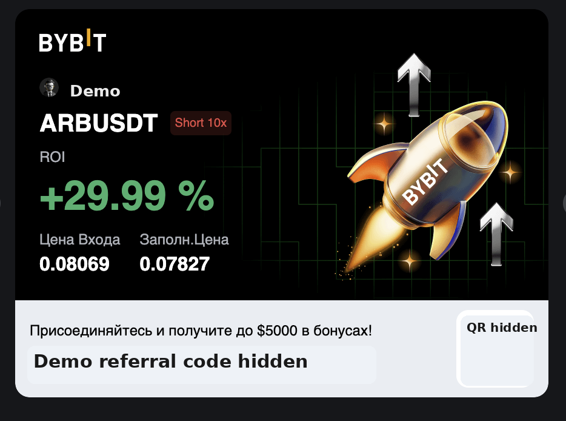
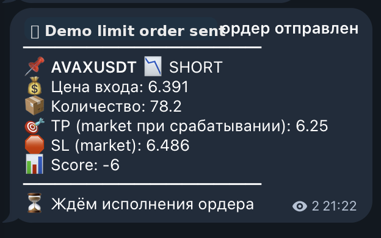
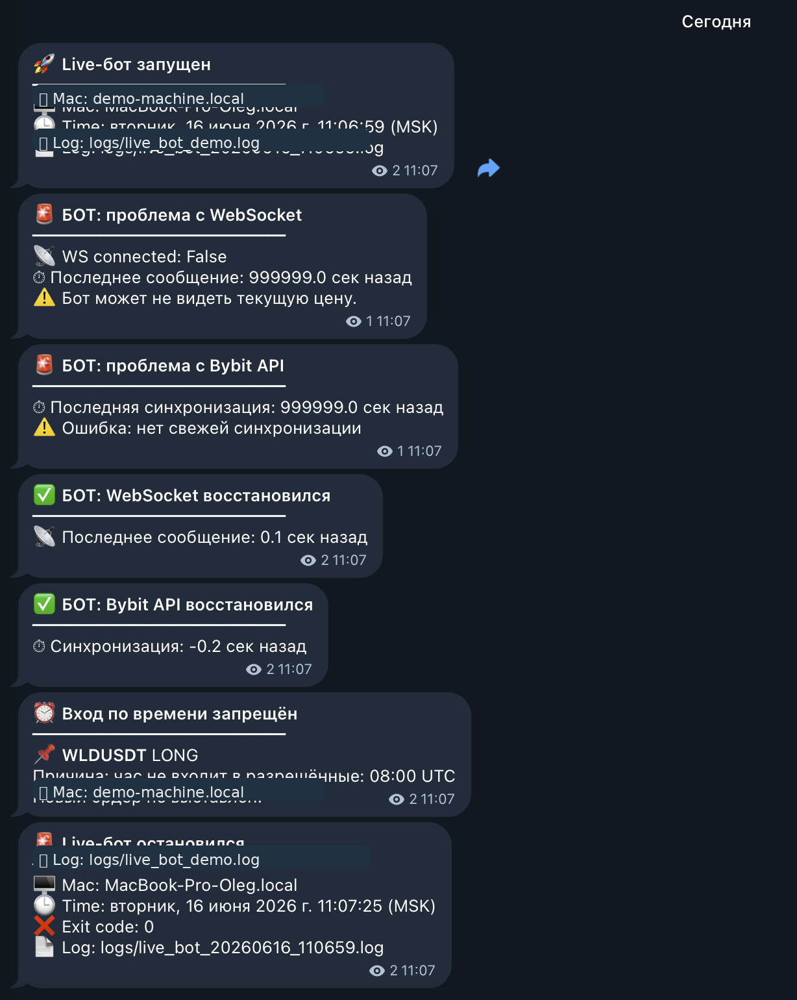
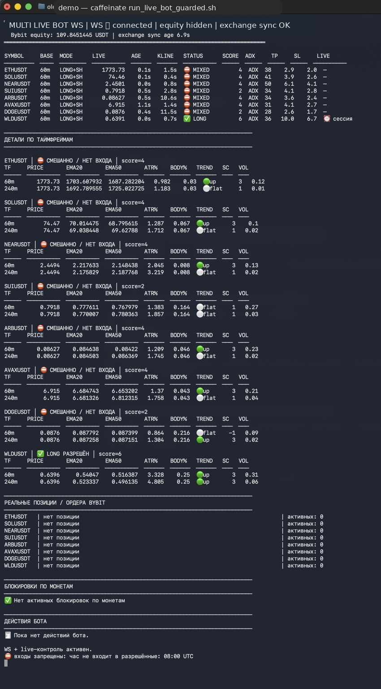

# 📈 Bybit Trading Bot — Paper & Live Mode

Python trading bot for Bybit with paper trading, WebSocket market data, configurable symbols, risk controls, trade logging, and optional live trading mode.

> ⚠️ This repository is for educational and portfolio purposes. It is not financial advice and does not guarantee profit.

## 🇬🇧 Short Description

**Bybit Trading Bot — Paper & Live Mode** is a Python-based trading automation project.

The bot is designed to process market data from Bybit, run a configurable trading strategy, manage risk limits, log trades, and support both safe paper trading and optional live trading.

The main focus of this repository is **architecture, risk management, configuration handling, and safe trading automation practices**.

---

## 🇷🇺 Краткое описание

**Bybit Trading Bot — Paper & Live Mode** — это Python-проект торгового бота для Bybit.

Бот получает рыночные данные, применяет настраиваемую торговую стратегию, контролирует риски, пишет сделки в лог и поддерживает безопасный paper trading, а также опциональный live-режим.

Основной фокус проекта — **архитектура, риск-менеджмент, конфигурация и безопасная автоматизация торговли**.

---

## 🖼️ Demo Screenshots

### Bybit result card



### Live order alert



### Bot monitoring alerts



### Live terminal dashboard



More details: [`docs/demo-screenshots.md`](docs/demo-screenshots.md)

---

## ✨ Features

- Paper trading mode
- Optional live trading mode
- Bybit WebSocket market data
- Multi-symbol configuration
- Risk management layer
- Trade logging
- Demo CSV output
- Environment-based secrets
- Safe public configuration examples

---

## 🧩 Architecture

```text
Bybit WebSocket Market Data
        ↓
Market Data Handler
        ↓
Strategy Logic
        ↓
Risk Manager
        ↓
Order Executor
        ↓
Paper Trading / Live Trading
        ↓
Trade Logger
```

More details: [`docs/architecture.md`](docs/architecture.md)

---

## 🛠️ Tech Stack

- Python
- Bybit API / WebSocket
- JSON configuration
- CSV trade logs
- Environment variables

---

## 📁 Repository Structure

```text
bybit-trading-bot-paper-live/
├── README.md
├── LICENSE
├── .gitignore
├── .env.example
├── docs/
│   ├── architecture.md
│   ├── setup-checklist.md
│   ├── risk-disclaimer.md
│   ├── security.md
│   ├── demo-screenshots.md
│   └── screenshots/
│       ├── 01-bybit-result-card.png
│       ├── 02-live-order-alert.png
│       ├── 03-bot-monitoring-alerts.png
│       └── 04-live-terminal-dashboard.png
├── src/
│   ├── multi_paper_bot_ws.py
│   ├── multi_live_bot_ws.py
│   ├── strategy.py
│   ├── risk_manager.py
│   └── config_loader.py
├── config/
│   └── symbol_config.example.json
├── data/
│   └── paper_trades_demo.csv
└── examples/
    └── sample_output.md
```

---

## ⚙️ Setup Outline

1. Create a local `.env` file from `.env.example`.
2. Configure Bybit API keys locally only.
3. Configure symbols in `config/symbol_config.example.json`.
4. Start with paper trading mode.
5. Review trade logs.
6. Test risk limits.
7. Use live trading only after full local testing.

---

## 🔐 Security Notes

Never commit:

- Bybit API key
- Bybit API secret
- `.env` files with real values
- real account IDs
- real balances
- real order IDs
- real wallet data
- private logs

Use `.env.example` and demo CSV files only.

See: [`docs/security.md`](docs/security.md)

---

## ⚠️ Risk Disclaimer

Trading cryptocurrency involves significant risk. Automated trading can lose money quickly due to market volatility, bugs, exchange issues, network problems, or incorrect configuration.

This repository does not provide financial advice.

See: [`docs/risk-disclaimer.md`](docs/risk-disclaimer.md)

---

## 📌 Project Tagline

**English:**  
Python Bybit trading bot with paper trading, WebSocket market data, risk controls and optional live mode.

**Russian:**  
Python-бот для торговли на Bybit с paper trading, WebSocket-данными, риск-контролем и опциональным live-режимом.

## Maintenance checklist

These are verification tasks, not evidence that live trading is safe or that the checks have passed. Record paper-only or mocked inputs, observed outcomes, and the tested commit; leave unperformed checks marked untested.

Maintenance note: verify rejected orders are clearly recorded as rejected and never counted as open positions.

Maintenance note: confirm paper-mode logs never contain live account identifiers before publishing examples.

Maintenance note: confirm the configured symbol list is reviewed before every live-mode session.

Maintenance note: verify WebSocket reconnects restore subscriptions without duplicating local position state.

Maintenance note: verify system clock synchronization before live-mode sessions so signed API requests use valid timestamps.

Maintenance note: confirm live mode cannot start when required risk-limit configuration is missing or invalid.

Maintenance note: keep paper and live trade logs clearly separated so demo results cannot be mistaken for real-account activity.

Maintenance note: review live-session logs for unexpected retries or duplicate order attempts before the next run.

Maintenance note: confirm live API keys use only the minimum permissions required for trading and never withdrawal access.

Maintenance note: document whether each setup example targets testnet or mainnet so portfolio users cannot confuse the environments.

Maintenance note: confirm portfolio screenshots never expose live balances, wallet values, or account identifiers.

Maintenance note: reject non-finite or negative numeric risk settings during config loading before paper or live execution begins.

Maintenance note: capture a sanitized risk-configuration snapshot before each live session so later log review can verify the intended limits.

Maintenance note: verify the exchange-reported position state matches local state before enabling a new live session after restart.

Maintenance note: record a non-sensitive configuration fingerprint for each live session so later logs can be matched to the reviewed settings without storing secrets.

Maintenance note: require a fresh reconciliation of open orders and positions immediately before switching from paper mode to live execution.

Maintenance note: invalidate any prior live-session readiness marker if symbol, leverage, or risk settings change after reconciliation.

Maintenance note: expire live-session readiness after a short documented interval so a stale reconciliation cannot authorize later execution.

Maintenance note: immediately before any live order, confirm the current exchange symbol status is tradable and matches the reconciled configuration.

Maintenance note: verify a paper-mode retry after stale market data starts from a fresh snapshot and cannot inherit a prior readiness result.

Maintenance note: after reconnect, discard in-flight readiness results from the previous connection generation and verify they cannot authorize a live order.

Maintenance note: invalidate readiness when instrument filters refresh, even if the symbol name is unchanged, so sizing always uses one current metadata snapshot.

Maintenance note: before live submission, reject a stale readiness result if order type, time-in-force, reduce-only, or instrument metadata changed; recalculate sizing and price/quantity rounding against one current snapshot.

Maintenance note: verify a rejected live submission records the reason while leaving both exchange state and local open-position state unchanged.

Maintenance note: verify changing reduce-only invalidates live readiness before order submission.

Maintenance note: verify live price and quantity rounding use the same current instrument metadata snapshot as readiness validation.

Maintenance note: verify a rejected reduce-only live order records the reason without creating or changing a local position.

Maintenance note: verify stale market data blocks live submission before sizing, rounding, or local position state is created.

Maintenance note: verify the market-data timestamp is rechecked immediately before live submission and stale snapshots fail closed.

Maintenance note: verify a reconciled live-order retry reuses the original client order identifier instead of creating a second intent.

Maintenance note: after a live-order timeout, reconcile exchange open orders by client identifier before any retry.

Maintenance note: document the startup reconciliation order for positions, open orders, and local strategy state before enabling new live orders.

Maintenance note: verify paper and live modes are clearly identified in startup logs and exported execution summaries.

Maintenance note: document price and quantity precision rounding before order validation in both paper and live modes.

Maintenance note: document clock-skew handling and the safe response when an exchange rejects a stale request timestamp.

Maintenance note: document the shutdown fail-safe for cancelling open orders and confirming the final exchange state.

Maintenance note: document startup validation for position size, leverage, and loss limits before live trading is enabled.

Maintenance note: document the market-data freshness threshold that blocks new orders when quotes become stale.

Maintenance note: document the safe trading pause used during exchange maintenance or degraded API status.

- Document order-state handling for partial fills so cancellation and position reconciliation remain deterministic; use paper-only partial-fill fixtures followed by cancel success, cancel rejection, and ambiguous timeout to specify filled quantity, remaining order state, fees, and the block on replacement orders until reconciliation completes.

- Document how duplicate exchange events are detected before updating local order and position state.

- Document the reconciliation rule used when local order state conflicts with the exchange's final status; use paper-only fixtures for locally open orders reported as filled, cancelled, or missing to define the authoritative evidence, required fill and balance checks, and the condition that blocks new submissions until uncertainty is resolved.

- Document the maximum age allowed for account-balance data before a new order is rejected as unsafe; use paper-only snapshots below, at, and above the documented age limit, plus a missing timestamp, to define boundary decisions and keep unresolved freshness blocked without real credentials or order submission.

- Document how the bot distinguishes exchange rejection, timeout, and unknown order status before any retry; use paper-only mocked explicit rejection, no-response timeout, late acknowledgement, and missing-order lookup to specify reconciliation by client identifier, retry prohibition under uncertainty, and operator-visible final state.

- Document startup handling of open orders for excluded symbols using a paper-only fixture; keep those orders visible for reconciliation and unresolved exposure blocked from new strategy orders, without silently ignoring them or automatically cancelling protective orders.

- Document how risk limits are revalidated immediately before submitting an order after a delayed market-data response; use paper-only fresh, stale, and refreshed quote fixtures to rerun position, balance, exposure, and loss-limit checks, blocking submission when any input remains stale or the recalculated size exceeds a limit.

- Document how partial position closures update remaining risk and protective-order expectations; use paper-only long and short fixtures with partial close fills to recalculate remaining exposure, stop quantity, and loss-at-stop, blocking new entries when protective coverage is missing or exceeds the reconciled position.

- Document how protective orders are checked after reconnecting to the exchange following a network interruption; use paper-only fixtures with present, missing, duplicate, and mismatched stop orders to specify position-first reconciliation, blocked new entries, and explicit operator visibility without automatically modifying live orders.

- Document how stale websocket events are rejected after a successful account-state resynchronization.

- Document how order sizing is rechecked after a partial fill changes available balance or exposure.

- Document protective-order quantity review after a partial position close using paper-only long and short snapshots; compare remaining position size with protective quantities, specify rounding and unresolved-state blocking, and verify no proposed quantity can exceed the remaining exposure without submitting orders.

- Document the circuit-breaker behavior used after repeated order rejections in live mode; use mocked paper-only sequences below and at the threshold to specify when new submissions are blocked, how unresolved orders are reconciled, and which explicit reset condition is required before trading may resume.

- Document manual circuit-breaker reset prerequisites using paper-only unresolved and reconciled snapshots; require review of the triggering rejection, current risk settings, and open-order state, keeping reset blocked while checks are unresolved and never treating restart as automatic approval.

- Document how the bot verifies no untracked exposure remains before live trading resumes after a circuit-breaker stop.

- Document startup validation of API-key permissions without logging credentials or other sensitive values.

- Document rate-limit backoff using exchange reset metadata so retries cannot create an order storm; use mocked valid, missing, and expired reset metadata in paper mode to define bounded fallback delays, retry limits, and reconciliation of unknown submission outcomes before any order retry.

- Document how symbol precision or minimum-order changes are detected before retrying a pending order; use a paper-only changed-metadata fixture to revalidate quantity, price, and notional, blocking invalid retries rather than increasing size automatically to meet a new minimum.

- Document how fees and funding adjustments are reconciled before reporting paper-versus-live performance; use synthetic reports with identical periods, currencies, and cost conventions to distinguish gross, net, and provisional results, marking missing costs explicitly instead of treating them as zero.

- Document safe behavior when a configured instrument becomes suspended, delisted, or unavailable for trading; use mocked paper-only status changes to specify blocked new orders, reconciliation of existing exposure, and an operator alert without automatically substituting another instrument.

- Document how exchange maintenance notices gate new orders while existing positions and protective orders remain monitored; use paper-only degraded and recovered status fixtures to specify blocked submissions, stale-monitoring alerts, and reconciliation required before resuming without cancelling protective orders automatically.

- Document restart reconciliation of open orders by exchange order ID before automated strategy execution resumes; compare synthetic local and exchange snapshots in paper mode to classify matched, missing, and untracked orders, keeping execution blocked until unresolved states are reviewed without blindly resubmitting them.

- Document clock-drift detection and order blocking before authenticated exchange requests are signed; use paper-only mocked offsets below, at, and above the configured tolerance to specify blocking and revalidation, treating an unavailable time check as unresolved without changing the host clock or using real keys.

- Document a startup preflight that blocks orders when the configured position mode differs from the exchange account mode; use paper-only mocked matching, mismatched, and unavailable mode responses to specify readiness decisions, keeping unresolved checks blocked without automatically changing the account mode or submitting orders.

- Document the market-data freshness threshold that blocks order placement when ticker or order-book updates become stale; use paper-only fresh-ticker/stale-book and stale-ticker/fresh-book fixtures to specify required inputs and keep order placement blocked until every required feed is current.

- Document WebSocket sequence-gap recovery and require a fresh account snapshot before automated trading resumes; use a paper-only synthetic stream with a missing sequence and duplicate replay to specify order blocking, snapshot reconciliation, and the explicit condition for resuming without double-counting fills.

- Document instrument-metadata freshness checks for minimum notional, tick size, and lot size before order validation; use paper-only fresh, stale, and missing metadata fixtures to define refresh and blocking decisions, then revalidate rounding against changed increments without submitting orders.

- Document an unmistakable startup confirmation of paper versus live mode before credentials or order routes are activated; use mocked paper, live, missing, and conflicting mode settings to specify the visible mode banner and fail-closed behavior without loading real credentials or enabling order submission.

- Document shutdown verification for cancel-all requests, including reconciliation of orders still reported as open; use paper-only acknowledged, timed-out, and partially cancelled responses to distinguish request acceptance from confirmed closure and report unresolved orders without claiming a clean shutdown.

- Document order-client identifier uniqueness and restart recovery to prevent accidental duplicate submissions; use a paper-only interrupted submission with an unknown outcome to specify identifier persistence and reconciliation before any replacement order is allowed.

- Document reconciliation of partial-fill fees before realized profit and loss is recorded or displayed; use paper-only fills with different fee amounts and a delayed fee correction to specify rounding, provisional totals, and the reconciled result without counting either fill twice.

- Document post-reconnect position reconciliation before any strategy is allowed to submit a new order; compare a stale local position with a synthetic fresh snapshot in paper mode and specify that unresolved mismatches keep order submission blocked.

- Document fee-currency conversion timestamps so portfolio reports can reproduce historical net results; use a paper-only fixture with a fee in another currency to record rate source, quote timestamp, rounding, and the expected converted amount without live account data.

- Document an API-permission preflight that confirms trading access while rejecting unnecessary withdrawal privileges; use mocked permission responses for allowed, read-only, and withdrawal-enabled keys to specify expected decisions without real credentials or exchange requests.

- Document funding-fee reconciliation so periodic charges are included consistently in paper and live performance reports; use paper-only positive, negative, missing, and duplicate funding events to verify identifier, currency, timestamp, and expected net-PnL treatment without live account data.

- Document market-snapshot timestamps used for order validation so stale depth data can be identified in audits; use paper-only snapshots just inside and outside the freshness threshold to record source time, receipt time, and the expected allow-or-block decision without exchange credentials.

- Document exchange risk-tier verification before order sizing so leverage assumptions remain valid after tier changes; use mocked unchanged, changed, and unavailable tier responses in paper mode to specify revalidation and blocking behavior without altering live leverage or submitting orders.

- Document balance-source selection and rounding rules used when calculating available order margin; use paper-only synthetic snapshots to record the selected balance field, precision, and expected result at zero and rounding boundaries without submitting orders.

- Document execution-identifier deduplication so repeated exchange responses cannot double-count fills or fees; replay one synthetic fill twice in a paper-only fixture and compare fill count, quantity, and fee totals with a single replay.

- Document price and quantity rounding direction for reduce-only orders so position closure cannot accidentally increase exposure; use paper-only long and short fixtures near exchange increments to verify the rounded quantity never exceeds the remaining position or flips its side.

- Document stale-order cancellation after reconnecting before any replacement order is submitted; use a paper-only fixture with an unresolved cancellation and verify replacement remains blocked until the open-order state is reconciled.

- Document the configured trigger-price source for protective orders so mark, index, and last-price semantics cannot be confused; use paper-only synthetic snapshots where the sources diverge to verify the selected source, audit output, and fail-closed behavior when exchange metadata disagrees.

- Document liquidation-price and maintenance-margin fields as informational risk indicators rather than executable guarantees; use paper-only synthetic long and short positions near tier boundaries to record the exchange source, timestamp, rounding, and unavailable-state behavior without inferring safety from a stale value.

- Document cancel-replace behavior when an order amendment has an unknown outcome; use paper-only acknowledged, rejected, timed-out, and partially filled fixtures to require reconciliation by exchange and client identifiers before any replacement is submitted, preventing duplicate exposure.

- Document order-book checksum or sequence-integrity validation before depth data is used for entry decisions; use paper-only valid, mismatched, unavailable, and recovered snapshots to specify order blocking, resubscription, and the fresh-snapshot condition required before resuming.

- Document reconciliation when leverage or margin mode is changed externally while the bot is running; use paper-only matching, changed, and unavailable account snapshots to block new orders, preserve protective-order monitoring, and require explicit state confirmation before strategy execution resumes.

- Document exchange price-band validation before limit and protective orders are submitted; use paper-only prices below, at, and above synthetic bounds to define rounding, rejection, refresh of stale limits, and fail-closed behavior without automatically moving an order to a materially different price.

- Document reconciliation when a manual external position appears for a symbol the bot considers flat; use paper-only matching, conflicting, and unavailable position snapshots to block new entries, avoid adopting or closing an unowned position automatically, and require explicit operator resolution.

- Document runtime behavior when API-key permissions are reduced or become read-only; use paper-only authenticated, permission-denied, and recovered responses to halt new orders, preserve local reconciliation evidence, avoid repeated unauthorized requests, and require a successful capability preflight before resuming.

- Document risk revalidation when wallet equity changes because of a manual transfer between signal evaluation and order submission; use paper-only increased, decreased, unchanged, and unavailable balances to recompute or block size according to policy without exceeding configured exposure.

- Document recovery from sequence gaps in private order, execution, position, and wallet streams; use paper-only contiguous, duplicate, skipped, and reordered events to pause new orders, fetch an authoritative snapshot, and resume only after state reconciliation without replaying fills twice.

- Document behavior when an instrument enters pre-delisting, suspended, or settlement status while orders or positions exist; use paper-only status transitions to block new entries, reconcile open orders and protective coverage, and require explicit operator review without assuming a tradable exit.

- Document refresh behavior when an instrument's funding interval or next-funding timestamp changes during a session; use paper-only unchanged, shortened, extended, and unavailable schedules to invalidate stale forecasts, preserve recorded fills, and block funding-sensitive entries until current metadata is confirmed.

- Document collision handling for deterministic client order IDs after restart or restored state; use paper-only unique, repeated-same-intent, repeated-different-intent, and lookup-unavailable cases to reconcile before submission, reuse only an exact known order, and never overwrite a conflicting intent.

- Document complete pagination of open-order and execution snapshots used for reconciliation; use paper-only zero-page, single-page, multi-page, repeated-cursor, and missing-cursor responses to bound traversal, deduplicate by stable identifiers, and keep trading blocked when the snapshot may be incomplete.

- Document fail-closed behavior during announced or detected exchange API maintenance windows; use paper-only upcoming, active, extended, ended, and status-unavailable fixtures to block new orders, preserve protective-order monitoring where available, bound retries, and require a fresh authoritative reconciliation before trading resumes.

- Document API time-synchronization checks for timestamp and `recv_window` validation; use paper-only aligned, drifting, corrected, and server-time-unavailable fixtures to block signed order actions outside the configured tolerance, keep retries bounded, and resume only after a fresh authenticated reconciliation.

- Document reconciliation when REST snapshots and private WebSocket streams disagree about orders, positions, or balances; use paper-only newer-snapshot, newer-stream, missing-sequence, and timestamp-ambiguous fixtures to define source precedence, block new exposure during uncertainty, and resume only after one coherent authoritative state is confirmed.

- Document metadata refresh when an instrument's tick size, quantity step, minimum size, or price scale changes during a session; use paper-only unchanged, tightened, loosened, and unavailable rule fixtures to revalidate pending intents, block stale submissions, and never round an order into materially different exposure automatically.

- Document reconciliation after a partial liquidation or auto-deleveraging event changes position size outside the strategy's order flow; use paper-only synthetic reductions, full closure, duplicate events, and unavailable snapshots to block new exposure, re-evaluate protective orders, and require an authoritative position and balance check before resuming.

- Document risk revalidation when the exchange changes a position's risk-limit tier or maintenance-margin schedule during a session; use paper-only unchanged, increased, decreased, rejected, and unavailable tier fixtures to block stale sizing, preserve existing protective monitoring, and require a fresh authoritative margin snapshot before new exposure.

- Document protective-order reconciliation after an entry is partially filled; use paper-only zero-fill, incremental-fill, final-fill, cancellation, and delayed-execution fixtures to size reduce-only protection from authoritative filled quantity, avoid uncovered exposure or over-close orders, and block replacement while fill state is uncertain.

- Document post-only entry handling when market movement makes an order immediately executable; use paper-only accepted, rejected, repriced, delayed-acknowledgement, and unknown-outcome fixtures to preserve maker-only intent, bound replacements, prevent accidental taker exposure, and reconcile authoritative order state before retrying.

- Document conditional-order trigger-source validation for last, mark, and index prices; use paper-only matching, divergent, unavailable, changed-configuration, and delayed-trigger fixtures to bind each order to the reviewed source, prevent silent fallback, and reconcile authoritative order state before any replacement.

- Document self-match-prevention behavior when concurrent strategy intents could trade against the same account; use paper-only non-crossing, crossing, partial-fill, cancel-newest, cancel-oldest, and unavailable-policy fixtures to preserve the configured rule, avoid artificial volume and fees, and reconcile both orders before resuming submissions.

- Document `close-on-trigger` semantics for protective conditional orders; use paper-only full-position, partial-position, already-flat, conflicting-open-order, delayed-trigger, and unknown-outcome fixtures to prevent exposure increases, cancel only documented conflicting orders, and reconcile authoritative position and order state before replacement.

- Document quantity-unit conversion for linear, inverse, and contract-denominated instruments; use paper-only base-quantity, quote-value, contract-count, boundary-rounding, and unavailable-metadata fixtures to size from authoritative instrument rules, block ambiguous orders, and report risk in one documented unit without silent conversion.

- Document handling when a `reduce-only` order is rejected because the authoritative position is already flat, smaller, or on the opposite side; use paper-only matching, flat, partial, flipped, delayed-snapshot, and unknown-outcome fixtures to avoid opening exposure, reconcile position and open orders, and retry only with a freshly validated quantity.

- Document fee-schedule refresh when maker, taker, or account-tier rates change during a session; use paper-only unchanged, increased, decreased, unavailable, and stale-cache fixtures to recompute expected costs before new exposure, preserve existing protective orders, and block entries whose documented edge no longer clears the configured threshold.

- Document position and PnL reconciliation across a funding settlement window; use paper-only before-settlement, exact-boundary, delayed-charge, duplicate-record, missing-record, and corrected-record fixtures to attribute funding once, avoid changing protective orders from provisional PnL, and require authoritative history before final reporting.

- Document trailing-stop activation and callback-unit validation; use paper-only inactive, activated, percentage, absolute-distance, tick-rounded, gap-through, and unavailable-metadata fixtures to derive values from authoritative instrument rules, prevent immediate unintended triggers, and reconcile order and position state before replacement.

- Document detection of an account position-mode change after startup; use paper-only unchanged, one-way-to-hedge, hedge-to-one-way, open-order, open-position, delayed-snapshot, and unavailable-mode fixtures to stop new submissions, preserve protective orders, and require authoritative reconciliation before resuming.

- Document refresh of instrument risk tiers and maintenance-margin rules during a session; use paper-only unchanged, tightened, relaxed, stale-cache, unavailable, and open-position fixtures to recalculate allowable exposure before new orders, preserve protective orders, and block submissions when authoritative tier data is unresolved.

- Document handling when an instrument changes to suspended, close-only, pre-delisting, or unavailable status during a session; use paper-only normal, entry-disabled, exit-allowed, metadata-stale, open-position, and open-order fixtures to block new exposure, retain documented protective management, and require authoritative status before resuming.

- Document the authoritative boundary for resetting daily loss and trade-count limits; use paper-only before-boundary, exact-boundary, delayed-fill, funding-posted-late, clock-skew, and restart fixtures to assign events to one UTC risk day, prevent premature budget restoration, and reconcile realized results before enabling new exposure.

- Document market-order slippage protection and exchange price-band validation; use paper-only normal-depth, thin-book, gap, stale-book, unavailable-band, partial-fill, and rejected-order fixtures to cap executable deviation from the reviewed reference, block ambiguous submissions, and reconcile authoritative fills before any retry.

- Document freshness and source selection for mark-price-based margin, liquidation-distance, and unrealized-PnL checks; use paper-only current, stale, divergent-index, missing, delayed, and corrected-price fixtures to block new exposure when risk valuation is unresolved, preserve protective orders, and report one authoritative timestamped source.

- Document revalidation of existing open orders when tick size, quantity step, minimum value, or price-band metadata changes; use paper-only unchanged, tightened, relaxed, now-invalid, partially-filled, and unavailable-filter fixtures to stop replacements and new exposure, preserve valid protective intent, and require authoritative order status before amend or cancel decisions.

- Document self-match-prevention behavior when multiple strategies or sessions submit opposing orders for the same account; use paper-only cancel-newest, cancel-oldest, cancel-both, stale-setting, partial-fill, and unsupported-mode fixtures to prevent unintended self-trades, preserve protective intent, and reconcile authoritative order state before any resubmission.

- Document detection of exchange API-key permission or IP-allowlist drift during a session; use paper-only trading-enabled, read-only, permission-revoked, IP-rejected, stale-capability, and restored fixtures to block new signed actions immediately, preserve local risk state, avoid credential fallback, and resume only after a fresh authenticated capability check and reconciliation.

- Document shared exchange API-rate budgeting when multiple bot instances or strategies use the same account; use paper-only single-instance, concurrent-burst, weighted-endpoint, exhausted-budget, stale-counter, and restart fixtures to coordinate bounded requests, prioritize reconciliation and protective monitoring, block new exposure during uncertainty, and avoid retry storms.

- Document private WebSocket authentication expiry and session renewal during trading; use paper-only valid, near-expiry, expired, rejected-renewal, duplicate-session, network-drop, and REST-divergence fixtures to pause new exposure, preserve protective monitoring where authoritative, bound reconnect attempts, and resume only after a fresh authenticated reconciliation.

- Document execution-event deduplication by authoritative exchange identifiers; use paper-only unique, duplicate, reordered, partially-filled, corrected, missing-id, and reconnect-replay fixtures to apply each fill once, reconcile cumulative quantities and fees, block new exposure when identity is ambiguous, and preserve an auditable non-secret event reference.

- Document commission-asset and fee-currency normalization for fills and realized PnL; use paper-only quote-fee, base-fee, third-asset, rebate, corrected-fee, missing-rate, and delayed-conversion fixtures to preserve authoritative raw amounts, value them with one timestamped source, avoid double counting, and block risk-budget reuse when net results are unresolved.

- Document refresh of collateral eligibility, discount factors, and valuation rules in unified-account risk calculations; use paper-only unchanged, tightened, removed-collateral, stale-price, missing-factor, open-position, and restored fixtures to recalculate available margin conservatively, block new exposure while unresolved, preserve protective orders, and retain authoritative raw balances.

- Document borrowed-asset liabilities and interest accrual in unified-account risk calculations; use paper-only no-liability, accrued-interest, delayed-posting, repayment, partial-repayment, rate-change, and valuation-unavailable fixtures to preserve authoritative principal and interest separately, prevent overstated equity, block new exposure when unresolved, and reconcile before risk-budget reuse.

- Document reconciliation of wallet, account, or subaccount transfers that change available equity during a session; use paper-only inbound, outbound, pending, failed, reversed, duplicate, and history-unavailable fixtures to separate transfers from trading PnL, pause new exposure while balances disagree, preserve protective orders, and resume only after authoritative wallet and position snapshots align.

- Document maker/taker fee-tier changes during an active session; use paper-only maker, taker, tier-upgrade, tier-downgrade, delayed-rate, rebate, and unavailable-rate fixtures to calculate fees from authoritative execution data, keep estimates separate from settled PnL, block risk-budget reuse while fees disagree, and reconcile before resuming new exposure.

- Document immediate-or-cancel and fill-or-kill order outcomes before either mode is enabled; use paper-only full-fill, partial-fill, no-fill, late-status, duplicate-execution, fee, and unsupported-instrument fixtures to reconcile authoritative executions, avoid treating cancelled remainder as open exposure, preserve protective orders, and block retries while state is ambiguous.

- Document exchange cancel-on-disconnect behavior before enabling it for any session; use paper-only armed, unsupported, connection-loss, reconnect, delayed-cancel, partial-fill, and protective-order fixtures to distinguish session orders from safeguards, reconcile authoritative order and position state after reconnect, avoid duplicate replacements, and block new exposure while outcomes are unknown.

- Document private-stream sequence reset after reconnect or an exchange-side restart; use paper-only continuous, reset, gap, duplicate, reordered, snapshot-delayed, and unavailable-history fixtures to discard stale deltas, rebuild order and position state from authoritative snapshots, preserve protective orders, and block new exposure until the stream and snapshot agree.

- Document paginated REST history reconciliation for executions, orders, fees, and transfers; use paper-only empty, single-page, overlapping-page, missing-page, cursor-loop, late-arrival, and retention-boundary fixtures to deduplicate by authoritative identifiers, preserve stable time windows, detect incomplete history, keep protective orders untouched, and block risk-budget reuse until totals reconcile.

- Document exchange execution corrections, trade busts, or reversed fills before live support is enabled; use paper-only original, corrected-quantity, corrected-price, full-reversal, fee-adjustment, delayed-notice, and duplicate-notice fixtures to preserve an immutable event trail, rebuild realized PnL and exposure from authoritative records, keep protective orders reconciled, and block new risk while totals disagree.

- Document instrument symbol or contract-identifier migration when an exchange renames or replaces a market; use paper-only unchanged, renamed, overlapping, delisted-old, open-order, open-position, and history-replay fixtures to map authoritative identifiers explicitly, prevent cross-contract reconciliation, preserve protective orders, keep historical PnL attached to the original contract, and block new exposure until mapping is verified.

- Document contract-multiplier or settlement-unit changes for an existing exchange instrument; use paper-only unchanged, increased, decreased, delayed-metadata, open-order, open-position, and history-replay fixtures to recalculate quantities and PnL from authoritative contract specifications, keep historical executions tied to their original multiplier, preserve protective intent, and block new exposure until reconciliation completes.

- Document maintenance-margin or risk-tier changes while exposure is open; use paper-only unchanged, tier-increase, tier-decrease, delayed-metadata, threshold-crossing, open-order, and unavailable-tier fixtures to recompute liquidation distance and available risk from authoritative specifications, preserve protective orders, prevent automatic leverage increases, and block new exposure until account and instrument tiers reconcile.

- Document persistence of a configured daily risk halt across process restarts and reconnects; use paper-only below-limit, limit-reached, restart, timezone-boundary, late-fee, corrected-execution, and manual-review fixtures to rebuild the trading-day result from authoritative records, keep new exposure blocked after the limit is reached, preserve protective orders, and require an explicit next-day boundary before reset.

- Document reconciliation when the exchange-reported account architecture changes between sessions; use paper-only unchanged, standard-to-unified, unified-to-standard, migration-pending, unavailable, open-position, and restored fixtures to block new exposure, preserve protective-order monitoring, rebuild balances and risk from authoritative snapshots, and require explicit operator review before resuming.

- Document reconciliation when trading fees are reported in an asset different from the position's quote or settlement asset; use paper-only expected-asset, alternate-asset, rebate, delayed-posting, missing-conversion, corrected-fee, and duplicate-event fixtures to retain authoritative fee units, value them conservatively for P&L, block risk conclusions when conversion is unavailable, and avoid rewriting execution history.

- Document order validation when exchange price bands or dynamic order-price limits change during a session; use paper-only inside-band, boundary, outside-band, narrowed-band, widened-band, stale-band, and unavailable-band fixtures to reject invalid new exposure before submission, preserve protective-order monitoring, refresh authoritative limits, and avoid silently moving the strategy's intended price.

- Document readiness behavior when an instrument's exchange-reported trading status changes; use paper-only continuous, auction, halted, closing, delisted, stale-status, and unavailable-status fixtures to block unsupported new exposure, preserve protective-order monitoring and reconciliation, avoid assuming market availability from cached data, and resume only after an authoritative status check.

- Document authoritative position-slot mapping when an account uses hedge-style long and short positions; use paper-only one-way, separate-long, separate-short, both-sides, missing-slot, stale-slot, and mode-changed fixtures to bind orders and protective actions to the correct exchange-reported position identifier, block ambiguous new exposure, and never infer a slot from order side alone.

- Document reconciliation of exchange-reported liquidation and bankruptcy prices after isolated-margin changes; use paper-only unchanged, margin-added, margin-removed, leverage-changed, delayed-update, unavailable-price, and corrected-snapshot fixtures to treat displayed thresholds as authoritative account data rather than stop orders, block new exposure while stale, preserve protective-order monitoring, and avoid locally inventing a replacement price.

- Document treatment of an exchange-reported auto-deleveraging ranking or indicator; use paper-only low, elevated, maximum, changed, stale, unavailable, and post-event fixtures to record the authoritative value separately from strategy signals, avoid using it as a locally invented liquidation trigger, preserve protective-order monitoring, block unsupported risk conclusions, and reconcile positions after any actual event.

- Document PnL and quantity-unit validation for linear and inverse contract models; use paper-only linear, inverse, matching-metadata, stale-model, missing-contract-value, changed-settlement-asset, and corrected-fill fixtures to select formulas only from authoritative instrument metadata, retain raw exchange units, block unsupported calculations, and avoid comparing unlike PnL amounts silently.

- Document decimal-precision handling for wallet balances, fees, realized PnL, and settlement amounts; use paper-only exact, sub-step, zero, very-large, scientific-notation, precision-changed, and corrected-snapshot fixtures to retain raw exchange strings, parse with decimal arithmetic, round only at the documented presentation or order boundary, block ambiguous calculations, and never infer spendable balance from rounded output.

- Document use of exchange-reported collateral eligibility and haircut rates in unified-account risk calculations; use paper-only eligible, ineligible, partial-haircut, rate-changed, stale-rate, missing-rate, and corrected-snapshot fixtures to value collateral only from authoritative account metadata, retain raw asset balances separately, block ambiguous new exposure, and never treat nominal wallet balance as fully spendable margin by default.

- Document reconciliation of exchange-reported risk-limit and maintenance-margin tiers as position size changes; use paper-only below-boundary, exact-boundary, above-boundary, tier-raised, tier-lowered, stale-tier, and corrected-snapshot fixtures to derive requirements only from authoritative instrument and account data, block ambiguous new exposure, preserve protective-order monitoring, and never extrapolate a tier from cached size alone.

- Document reconciliation of exchange-reported maker and taker fee rates when an account fee tier changes; use paper-only maker, taker, partial-fill, tier-upgrade, tier-downgrade, stale-rate, and corrected-fill fixtures to retain raw commission records, estimate costs only from authoritative account data, reconcile actual fills independently, block unsupported profitability claims, and never rewrite historical fees using the latest tier.

- Document generation and reconciliation of unique exchange `orderLinkId` values across restarts and retries; use paper-only new-order, retry-before-ack, delayed-ack, duplicate-submit, process-restart, historical-ID-reuse, and corrected-status fixtures to bind one client intent to one durable identifier, query authoritative order state before resubmission, block ambiguous duplicates, and keep strategy details out of identifiers.

- Document reconciliation when an account switches between one-way and hedge position modes; use paper-only flat-account, open-position, active-order, separate-long-short, delayed-mode-update, rejected-switch, and corrected-snapshot fixtures to trust authoritative account mode, bind orders to valid position slots, block new exposure during mismatch, preserve protective monitoring, and never infer a successful switch from a request acknowledgement alone.

- Document reconciliation of exchange-managed trailing stops with activation price and trailing distance; use paper-only inactive, activated, price-gap, partial-position-close, distance-amended, stale-update, rejected-update, and corrected-snapshot fixtures to retain authoritative trigger parameters, bind protection to the current position slot and side, block ambiguous replacement actions, and never simulate exchange trigger state from local prices alone.

- Document exchange price-protection and slippage-tolerance behavior for market orders; use paper-only within-tolerance, beyond-tolerance, thin-book, gap, partial-fill, IOC-style-remainder-cancel, stale-limit, and corrected-status fixtures to retain requested versus executed values separately, trust authoritative fills and rejections, block blind retries after ambiguous outcomes, and never report an unfilled remainder as position exposure.

- Document reconciliation of conditional-order trigger sources such as last, mark, or index price; use paper-only each-supported-source, missing-source, unsupported-source, source-changed, stale-metadata, price-divergence, triggered, and corrected-status fixtures to retain the exchange-reported trigger type with every order, evaluate risk displays against the matching authoritative feed, block ambiguous replacements, and never substitute a local default silently.

- Document validation of exchange-reported maximum order quantities for market and limit orders; use paper-only below-limit, exact-limit, above-limit, market-versus-limit, leverage-changed, stale-metadata, partial-fill, and corrected-metadata fixtures to retain the authoritative limit and requested quantity, block invalid submissions before exposure changes, avoid silently splitting strategy intent into multiple orders, and reconcile any accepted order from exchange status.

- Document reconciliation of exchange- and account-specific maximum leverage limits; use paper-only below-cap, exact-cap, above-cap, symbol-specific, risk-tier-change, account-restriction, stale-metadata, and corrected-metadata fixtures to retain requested and authoritative leverage separately, block unsupported new exposure, never increase leverage automatically after a cap rises, preserve protective monitoring, and reconcile accepted settings from authoritative position state.

- Document reconciliation of exchange- or risk-tier-specific maximum position-size limits; use paper-only below-cap, exact-cap, above-cap, cap-reduced, cap-increased, pending-order, partial-fill, stale-metadata, and corrected-snapshot fixtures to calculate remaining capacity from authoritative position and order state, block unsupported new exposure, preserve reduce-only protection, and never infer an accepted size increase from a request acknowledgement alone.

- Document reconciliation of exchange-managed auto-add-margin settings for isolated positions; use paper-only disabled, enabled, external-toggle, insufficient-balance, margin-added, rejected-change, delayed-snapshot, and corrected-snapshot fixtures to treat the authoritative position setting and balance effect separately, block unsupported new exposure during mismatch, preserve protective monitoring, and never assume a request acknowledgement changed liquidation risk.

- Document reconciliation of exchange TP/SL modes that apply protection to a full position or to partial quantities; use paper-only full-mode, partial-mode, mixed-orders, partial-fill, position-reduced, mode-changed, rejected-change, delayed-snapshot, and corrected-snapshot fixtures to retain authoritative mode and quantities with each protective order, block ambiguous replacement actions, preserve reduce-only intent, and never infer protection from local strategy state alone.

- Document reconciliation for dated or delivery contracts approaching expiry and settlement; use paper-only far-from-expiry, entry-cutoff, final-trading-window, open-position, open-order, delayed-settlement, missing-settlement-price, and corrected-history fixtures to derive deadlines only from authoritative instrument metadata, block unsupported new exposure at the reviewed boundary, preserve protective monitoring while available, and reconcile final PnL from exchange records without inventing a settlement price.

- Document reconciliation of unified-account wallet balance components such as total equity, available balance, initial margin, and maintenance margin; use paper-only flat, open-position, pending-order, unrealized-loss, collateral-haircut, delayed-component, internally-inconsistent, and corrected-snapshot fixtures to retain authoritative fields separately, avoid deriving spendable funds from one headline value, block unsupported new exposure on mismatch, and preserve protective monitoring.

- Document authoritative binding of `positionIdx` or equivalent position-slot identifiers in hedge mode; use paper-only long-slot, short-slot, one-way-mode, missing-index, wrong-index, mode-switched, partial-fill, stale-order, and corrected-snapshot fixtures to retain the exchange-reported slot with every order and fill, block ambiguous amendments or closes, preserve reduce-only protection, and never infer a slot from order side alone.

- Document reconciliation of pre-market or call-auction trading phases before placing orders; use paper-only not-started, auction-open, no-cancel-window, transition-to-continuous, halted, stale-phase, rejected-order, and corrected-status fixtures to trust authoritative instrument phase and allowed-order rules, block unsupported new exposure, preserve existing-order reconciliation, avoid substituting market orders silently, and resume only after a fresh status check.

- Document reconciliation of funding-rate cap, floor, and interval metadata before opening perpetual exposure; use paper-only normal, capped-positive, floored-negative, changed-interval, missing-field, stale-cache, corrected-response, and unsupported-symbol fixtures to trust current authoritative instrument data, avoid extrapolating a settlement charge silently, block only unsupported new exposure, preserve reduce-only exits, and record the decision without account or order identifiers.

- Document reconciliation of futures expiry and settlement metadata before opening exposure; use paper-only distant-expiry, near-expiry, settlement-only, expired, timestamp-correction, missing-field, stale-cache, and unsupported-symbol fixtures to trust the current authoritative contract state, block unsupported new exposure while preserving reduce-only exits, avoid rolling into another symbol silently, and record decisions without account or order identifiers.

- Document reconciliation when Bybit position mode changes between one-way and hedge mode; use paper-only flat, open-long, open-short, both-sides, pending-order, partial-fill, rejected-switch, and externally-corrected fixtures to trust authoritative account and position state, block unsupported new exposure, preserve reduce-only exits and order ownership, avoid remapping sides silently, and resume only after a fresh mode check.

- Document reconciliation when a Bybit account changes among classic, unified, and portfolio-margin modes; use paper-only flat, open-position, pending-order, borrowed-balance, unsupported-product, migration-in-progress, rejected-request, and corrected-state fixtures to trust authoritative account capabilities, block unsupported new exposure, preserve reduce-only exits and reconciliation, avoid translating balances or risk tiers silently, and resume only after a fresh mode and collateral check.

- Document reconciliation when API-key permissions change or become read-only; use paper-only valid-trading, read-only, revoked, expired, IP-restricted, partial-scope, delayed-permission, and restored-key fixtures to trust the latest authenticated capability response, block unsupported new exposure, preserve local reconciliation and reduce-only safety instructions without retry storms, avoid requesting broader permissions automatically, and record no key material or account identifiers.

- Document reconciliation when an instrument or position risk tier changes; use paper-only higher-limit, lower-limit, maintenance-margin-change, open-position, pending-order, stale-tier, rejected-adjustment, and corrected-response fixtures to trust authoritative tier and margin data, block unsupported new exposure, preserve reduce-only exits and existing-order reconciliation, avoid increasing leverage or limits silently, and record decisions without account or position identifiers.

- Document reconciliation when Bybit renames, migrates, or replaces an instrument symbol; use paper-only alias-announced, overlap-window, old-symbol-read-only, migrated-position, pending-order, stale-mapping, unsupported-successor, and corrected-metadata fixtures to trust authoritative instrument identifiers, block unsupported new exposure, preserve reduce-only exits and order ownership, avoid rolling positions or rewriting history silently, and record mappings without account or order identifiers.

- Document reconciliation when maker, taker, or settlement fee rates change; use paper-only normal, promotional, tier-upgrade, tier-downgrade, stale-cache, missing-field, corrected-response, and unsupported-product fixtures to trust current authoritative fee metadata, calculate estimates without presenting them as guaranteed fills, block only decisions that require unavailable fee data, preserve reduce-only exits, and record assumptions without account, volume, or order identifiers.

- Document reconciliation of dynamic order-price limits and price-band ratios before submission or amendment; use paper-only inside-band, exact-boundary, outside-band, rapidly-moving-reference, stale-limit, missing-field, corrected-response, and reduce-only-exit fixtures to trust current authoritative limits, block unsupported new exposure, avoid clamping prices silently, preserve safe exits where the venue permits them, and record decisions without account or order identifiers.

- Document Disconnect Cancel All or equivalent dead-man-switch reconciliation; use paper-only enabled, disabled, heartbeat-lost, reconnect-before-timeout, timeout-fired, partial-cancel, stale-status, and unsupported-account fixtures to trust authoritative venue state, distinguish venue cancellations from local intent, block unsupported new exposure until open orders are reconciled, preserve reduce-only exits where confirmed, and record no account, session, or order identifiers.

- Document reconciliation of Bybit API rate-limit headers and server retry guidance; use paper-only normal-budget, near-limit, exhausted, endpoint-specific, missing-header, contradictory-header, delayed-reset, and recovered cases to pace requests from authoritative metadata, prioritize position and order reconciliation over optional polling, avoid burst retries or clock guesses, block unsupported new exposure when state is stale, preserve reduce-only safety work, and record no account, key, or order identifiers.

- Document reconciliation when a collateral coin becomes eligible, ineligible, discounted, or borrowing-limited; use paper-only enabled, disabled, haircut-changed, borrow-quota-exhausted, stale-cache, missing-field, corrected-response, and open-position fixtures to trust authoritative collateral and liability data, block unsupported new exposure, preserve reduce-only exits and repayment reconciliation, avoid substituting collateral silently, and record no account, balance, or asset quantities.

- Document reconciliation when spot hedging mode is enabled, disabled, or unavailable; use paper-only enabled, disabled, unsupported-symbol, stale-mode, partial-fill, open-order, position-present, and corrected-response fixtures to trust authoritative account mode, block unsupported new exposure, keep reduce-only and cancellation safety work available, reconcile inventory before resuming, avoid silently netting incompatible positions, and record no account, key, order, or quantity identifiers.

- Document Market Maker Protection state reconciliation where supported; use paper-only enabled, triggered, reset-pending, disabled, unsupported-symbol, stale-status, open-order, and corrected-response fixtures to trust authoritative protection state, block unsupported new quoting, reconcile and cancel exposed orders before resuming, preserve reduce-only position safety, avoid automatic reset without policy approval, and record no account, key, order, or quantity identifiers.

- Document auto-repay and liability-settlement reconciliation where supported; use paper-only successful, partial, rejected, delayed, duplicate, stale-balance, insufficient-collateral, and corrected-response fixtures to trust authoritative liability and transaction state, block unsupported new borrowing, preserve reduce-only exits, avoid retrying a non-idempotent repayment blindly, reconcile balances before resuming, and record no account, key, asset, or quantity identifiers.

- Document ADL ranking and deleveraging-status reconciliation where reported; use paper-only low-rank, high-rank, rank-changed, position-reduced, stale-status, missing-field, duplicate-event, and corrected-response fixtures to trust authoritative position state, block unsupported new exposure when reconciliation is incomplete, preserve reduce-only exits, never predict or simulate an exchange deleveraging action, refresh risk state before resuming, and record no account, key, position, or quantity identifiers.

- Document order-amend acknowledgement and execution reconciliation; use paper-only accepted, rejected, partial-fill-before-ack, fill-after-request, cancelled-before-ack, duplicate-ack, stale-order-version, and corrected-response fixtures to trust authoritative order state, never infer an amendment from request success alone, block conflicting replacements while state is uncertain, preserve reduce-only safety, reconcile before retrying, and record no account, key, order, price, or quantity identifiers.

- Document execution-history pagination and gap detection during reconciliation; use paper-only single-page, multi-page, repeated-cursor, empty-middle-page, overlapping-results, late-fill, truncated-history, and corrected-response fixtures to order executions by authoritative identifiers and times, deduplicate without losing partial fills, stop on cursor loops, mark unresolved gaps as stale state, block unsupported new exposure until complete, and record no account, key, order, price, or quantity identifiers.

- Document exchange-time drift and timestamp-window recovery; use paper-only synchronized, local-clock-ahead, local-clock-behind, sudden-jump, stale-offset, rejected-request, repeated-sync, and recovered fixtures to derive offset only from authoritative server time, bound its lifetime, pause unsupported new exposure while signed requests are rejected, preserve reduce-only safety work where accepted, never adjust the host clock automatically, and record no account, key, request, or order identifiers.

- Document self-match-prevention configuration and resulting order events where supported; use paper-only cancel-maker, cancel-taker, cancel-both, unsupported-symbol, stale-setting, partial-fill, duplicate-event, and corrected-response fixtures to trust authoritative order outcomes, never infer a fill from prevention cancellation, block conflicting new exposure while state is uncertain, preserve reduce-only safety, reconcile before retrying, and record no account, key, order, price, or quantity identifiers.

- Document trailing-stop activation and amendment reconciliation; use paper-only inactive, activation-crossed, distance-amended, trigger-price-amended, partial-fill, cancelled-position, delayed-update, and corrected-response fixtures to trust authoritative conditional-order and position state, never infer activation from local price alone, block conflicting new protection while state is uncertain, preserve reduce-only safety, reconcile before retrying, and record no account, key, order, trigger, price, or quantity identifiers.

- Document isolated-margin add and reduce acknowledgements where supported; use paper-only add-margin, reduce-margin, insufficient-balance, liquidation-nearby, delayed-update, duplicate-request, rejected-request, and corrected-response fixtures to trust authoritative position and wallet state, never infer success from request acceptance alone, block conflicting new exposure while state is uncertain, preserve reduce-only safety, reconcile before retrying, and record no account, key, position, price, or quantity identifiers.

- Document market-order slippage-tolerance reconciliation where supported; use paper-only percent-bound, tick-bound, missing-setting, rejected-bound, partial-fill, delayed-fill, duplicate-update, and corrected-response fixtures to retain the requested protection separately from authoritative execution results, never infer a fill from acceptance, block unsupported new exposure while fill state is uncertain, preserve reduce-only safety, reconcile before retrying, and record no account, key, order, price, or quantity identifiers.

- Document reconciliation when an exchange rejects or resizes a reduce-only order; use paper-only valid-reduction, no-open-position, quantity-too-large, position-flipped, partial-fill, delayed-rejection, duplicate-event, and corrected-status fixtures to trust authoritative position and order state, never convert the request into opening exposure, block conflicting replacement while state is uncertain, reconcile before retrying, and record no account, key, order, price, or quantity identifiers.

- Document exchange open-order-count limit handling per symbol and account; use paper-only below-limit, exact-boundary, above-limit, conditional-order-counted, partially-filled, externally-cancelled, stale-count, and corrected-snapshot fixtures to trust authoritative active-order state, block only unsupported new submissions, preserve reduce-only protection, never cancel unrelated orders automatically, reconcile before retrying, and record no account, key, order, price, or quantity identifiers.

- Document API rate-limit headers and reset-window handling for order workflows; use paper-only ample-budget, near-limit, exhausted, missing-header, inconsistent-header, delayed-reset, duplicate-request, and recovered fixtures to pace requests from authoritative limits, never retry an order blindly after an unknown outcome, preserve reduce-only monitoring, block unsupported new exposure while reconciliation is pending, add bounded jitter without hiding urgency, and record no account, key, order, price, or quantity identifiers.

- Document instrument maximum-order-quantity and maximum-order-value changes during a session; use paper-only below-limit, exact-boundary, above-limit, market-specific-limit, reduce-only-exit, stale-metadata, missing-field, and corrected-response fixtures to trust current authoritative instrument rules, reject unsupported new exposure before submission, never split or clamp strategy intent silently, preserve safe exits where the venue permits them, reconcile before retrying, and record no account, key, order, price, or quantity identifiers.

- Document minimum-order-quantity and minimum-notional changes during a session; use paper-only below-minimum, exact-boundary, above-minimum, market-order-estimate, reduce-only-exit, stale-metadata, missing-field, and corrected-response fixtures to trust current authoritative instrument rules, reject unsupported new exposure before submission, never round strategy intent upward silently, preserve safe exits where the venue permits them, reconcile before retrying, and record no account, key, order, price, or quantity identifiers.

- Document reconciliation when a position is closed manually or by another authorized client while protective orders remain; use paper-only full-close, partial-close, side-flip, delayed-position-update, stop-still-open, take-profit-still-open, duplicate-event, and corrected-snapshot fixtures to trust authoritative position and order state, prevent orphan protection from opening exposure, cancel or amend only strategy-owned orders after reconciliation, block conflicting new exposure while state is uncertain, and record no account, key, order, price, or quantity identifiers.

- Document reconciliation of internal wallet transfers that change available trading balance; use paper-only initiated, completed, failed, delayed, duplicated, corrected, transfer-during-open-position, and unknown-status fixtures to trust authoritative wallet and transfer history, never increase risk budget from request acceptance alone, preserve reduce-only protection, block unsupported new exposure while balances disagree, reconcile before retrying, and record no account, key, transfer, asset, or amount identifiers.

- Document API permission or trading-capability revocation while the bot is running; use paper-only full-trading, read-only, order-create-denied, amend-denied, cancel-denied, permission-restored, stale-capability-cache, and unknown-response fixtures to trust current authoritative capabilities, stop unsupported new exposure immediately, preserve local monitoring and reduce-only safety actions only where confirmed available, reconcile before retrying, never attempt to widen permissions, and record no account, key, order, price, or quantity identifiers.

- Document reconciliation of orders expired or cancelled automatically by the exchange; use paper-only expired-by-time, cancelled-by-system, insufficient-margin, instrument-halted, partial-fill-then-expire, delayed-event, duplicate-event, and corrected-status fixtures to trust authoritative terminal reasons, never infer a fill or resubmit blindly, preserve reduce-only protection, block conflicting replacement while state is uncertain, reconcile before retrying, and record no account, key, order, price, or quantity identifiers.

- Document exact decimal parsing and rounding for exchange price, quantity, fee, balance, and PnL fields; use paper-only ordinary-decimal, trailing-zero, scientific-notation, maximum-precision, negative-fee-rebate, oversized-value, malformed-value, and corrected-response fixtures to preserve authoritative textual units, avoid binary floating-point decisions, apply instrument rounding only at reviewed order boundaries, block risk calculations on parse ambiguity, and record no account, key, order, price, or quantity identifiers.

- Document handling of unrecognized exchange enum values and response-schema drift; use paper-only unknown-order-status, unknown-position-status, unknown-side, added-field, missing-required-field, changed-type, delayed-correction, and restored-schema fixtures to preserve the authoritative raw state only in bounded internal handling, fail closed for new exposure when semantics are unclear, keep reduce-only protection only when independently confirmed safe, reconcile before retrying, and record no account, key, order, price, quantity, or raw payload identifiers.

- Document exchange timestamp drift and request-window failures during a session; use paper-only synchronized, local-clock-ahead, local-clock-behind, stale-response, network-delay, corrected-server-time, repeated-rejection, and restored-sync fixtures to rely on authoritative server time for request validation, never widen the accepted window silently, stop unsupported new exposure while timing is uncertain, preserve independently confirmed reduce-only protection, reconcile before retrying, and record no account, key, order, timestamp, price, or quantity identifiers.

- Document maintenance-margin and risk-limit tier changes during an open position; use paper-only unchanged-tier, increased-requirement, decreased-requirement, tier-boundary, leverage-adjusted, stale-metadata, delayed-position-update, and corrected-response fixtures to trust current authoritative tier rules, recompute liquidation safety without silently changing strategy intent, block unsupported new exposure while requirements disagree, preserve confirmed reduce-only protection, reconcile before retrying, and record no account, key, order, price, quantity, leverage, or margin identifiers.

- Document maker, taker, and other trading-fee-rate changes during a session; use paper-only unchanged-rate, maker-change, taker-change, account-tier-change, instrument-specific-rate, stale-cache, missing-rate, delayed-update, and corrected-response fixtures to trust current authoritative fee data, calculate estimates without rewriting filled-order history, never change order intent solely to chase a fee tier, block risk decisions that depend on ambiguous fees, reconcile before retrying, and record no account, key, order, rate, price, or quantity identifiers.

- Document tick-size, quantity-step, and instrument-precision changes during a session; use paper-only unchanged, finer-step, coarser-step, open-order-now-invalid, reduce-only-exit, stale-metadata, missing-field, delayed-update, and corrected-response fixtures to trust current authoritative instrument rules, never re-round submitted intent silently, amend or cancel only strategy-owned orders after reconciliation, preserve safe exits where the venue permits them, block unsupported new exposure, and record no account, key, order, price, or quantity identifiers.

- Document unavailable, stale, or divergent mark-price and index-price inputs during a session; use paper-only both-current, mark-missing, index-missing, stale-mark, stale-index, excessive-divergence, delayed-recovery, corrected-snapshot, and duplicate-update fixtures to trust only current authoritative price sources, stop new exposure and leverage-sensitive decisions while valuation is ambiguous, preserve independently confirmed reduce-only protection, never substitute last trade silently, reconcile before retrying, and record no account, key, order, price, quantity, or feed identifiers.

- Document external changes between isolated, cross, and supported portfolio margin modes while the bot is running; use paper-only unchanged-mode, isolated-to-cross, cross-to-isolated, unsupported-portfolio-mode, open-position, pending-order, stale-account-snapshot, delayed-update, and corrected-response fixtures to trust current authoritative account state, stop new exposure while margin semantics disagree, never migrate positions or collateral silently, preserve independently confirmed reduce-only protection, reconcile before retrying, and record no account, key, order, margin, price, or quantity identifiers.

- Document leverage changes made manually or by another authorized client while the bot is running; use paper-only unchanged, reduced-leverage, increased-leverage, rejected-change, delayed-position-snapshot, open-order-present, cross-margin, isolated-margin, repeated-event, and corrected-response fixtures to trust current authoritative position and account state, never restore the prior leverage silently, recompute risk before new exposure, preserve independently confirmed reduce-only protection, reconcile before retrying, and record no account, key, order, leverage, margin, price, or quantity identifiers.

- Document manual addition or removal of isolated position margin by another authorized client; use paper-only unchanged, margin-added, margin-removed, rejected-removal, delayed-position-snapshot, open-protection-orders, repeated-event, mode-changed, and corrected-response fixtures to trust current authoritative position margin, never reverse the external action silently, recompute liquidation and risk limits before new exposure, preserve independently confirmed reduce-only protection, reconcile before retrying, and record no account, key, order, margin, price, or quantity identifiers.

- Document an externally increased or newly opened position detected while the strategy is running; use paper-only same-side-increase, opposite-side-increase, side-flip, new-symbol-position, delayed-fill, partial-fill, unknown-order-owner, repeated-event, and corrected-snapshot fixtures to trust authoritative position and order state, never claim or manage unverified exposure as strategy-owned, block conflicting new orders, preserve only independently confirmed reduce-only protection, require explicit reconciliation before resuming, and record no account, key, order, price, quantity, or client identifiers.

- Document stop-loss or take-profit changes made manually or by another authorized client; use paper-only unchanged, stop-tightened, stop-widened, target-moved, protection-removed, partial-position, delayed-order-snapshot, repeated-event, and corrected-response fixtures to trust authoritative position and order state, never overwrite external protection silently or assume strategy ownership, block conflicting amendments and new exposure until reconciled, preserve only independently confirmed reduce-only safety, and record no account, key, order, trigger, price, or quantity identifiers.

- Document externally created open orders that are not attributable to the active strategy session; use paper-only manual-limit, manual-market-pending, stop-order, reduce-only, same-symbol, different-symbol, delayed-snapshot, duplicate-event, unknown-owner, and corrected-state fixtures to trust authoritative order and position state, never cancel, amend, or claim ownership without a verified strategy identifier, block conflicting new exposure until reconciled, preserve independently confirmed safety orders, and record no account, key, order, price, quantity, or client identifiers.

- Document externally created conditional orders that trigger while the strategy is running; use paper-only untriggered, triggered-open, triggered-filled, triggered-cancelled, same-symbol, opposite-side, reduce-only, delayed-order-snapshot, unknown-owner, repeated-event, and corrected-state fixtures to trust authoritative order and position state, never claim, amend, cancel, or replace unverified orders as strategy-owned, block conflicting new exposure until reconciled, preserve independently confirmed safety orders, and record no account, key, order, trigger, price, quantity, or client identifiers.

- Document WebSocket silence, sequence gaps, and reconnect recovery before accepting new trading decisions; use paper-only continuous-stream, missed-sequence, prolonged-silence, duplicate-event, out-of-order-event, reconnect-success, reconnect-stale-snapshot, REST-snapshot-disagreement, and corrected-stream fixtures to mark local state uncertain immediately, stop new exposure, preserve independently confirmed reduce-only protection, rebuild from an authoritative snapshot before replaying only validated newer events, and record no account, key, order, sequence, price, or quantity identifiers.

- Document cursor-based pagination completeness when reconciling order, execution, and transaction history; use paper-only single-page, exact-boundary, multi-page, duplicate-page, repeated-cursor, missing-cursor, empty-middle-page, late-arriving-record, overlapping-window, and corrected-query fixtures to enforce stable query bounds and explicit page budgets, deduplicate only by authoritative record identity, never treat a partial traversal as complete state, block new exposure until reconciliation is complete, and record no account, key, cursor, order, price, quantity, or transaction identifiers.

- Document timeout and retry policy during multi-page history reconciliation; use paper-only timeout-before-first-page, timeout-mid-page, timeout-between-pages, retry-same-cursor, late-response, rate-limit, query-window-split, maximum-page-budget, cancellation, and recovered fixtures to keep one immutable query boundary and cursor chain, discard ambiguous late pages, deduplicate only by authoritative record identity, never mark partial history complete, block new exposure until reconciliation succeeds or fails closed, and record no account, key, cursor, order, price, quantity, or transaction identifiers.

- Document client-order identifier allocation and reuse rules across submission retries; use paper-only unique-id, timeout-before-response, accepted-response-lost, duplicate-retry, same-id-different-payload, cancelled-order-id, rejected-order-id, process-restart, and corrected-status fixtures to bind one immutable strategy intent to one identifier, query authoritative state before retrying ambiguous submissions, never reuse an identifier for changed intent or infer acceptance from transport success alone, block conflicting new exposure while unresolved, and record no account, key, client-order, exchange-order, price, or quantity identifiers.

- Document structured handling of known and unknown exchange order-rejection reasons; use paper-only insufficient-balance, risk-limit, post-only-would-fill, reduce-only-conflict, invalid-step, market-closed, permission-denied, unknown-code, delayed-correction, and repeated-response fixtures to preserve authoritative terminal status and reviewed reason categories, never infer a fill or retry blindly, change strategy behavior only for explicitly supported reasons, keep state uncertain on unknown semantics, reconcile before retrying, and record no account, key, order, rejection, price, or quantity identifiers.

- Document contract-multiplier, settlement-asset, quote-asset, or value-unit changes in instrument metadata; use paper-only unchanged, multiplier-increased, multiplier-decreased, settlement-asset-changed, quote-asset-changed, stale-metadata, open-position, pending-order, delayed-update, and corrected-response fixtures to trust current authoritative specifications, stop new exposure and valuation while units disagree, never reinterpret historical fills or silently rescale strategy intent, preserve independently confirmed reduce-only protection where valid, reconcile before retrying, and record no account, key, order, asset, price, or quantity identifiers.

- Document instrument-status transitions such as pre-open, trading, suspended, delivering, and closed; use paper-only expected-transition, unexpected-transition, stale-status, delayed-update, open-position, pending-order, reduce-only-exit, conflicting-stream, and corrected-response fixtures to trust current authoritative metadata, stop new exposure whenever trading eligibility is uncertain, preserve independently confirmed protective actions where supported, reconcile before retrying, and record no account, key, order, symbol, price, or quantity identifiers.

- Document wallet-asset lifecycle changes such as trading suspension, settlement-only status, delisting, or withdrawal-only status; use paper-only unchanged, announced-delisting, immediate-suspension, stale-metadata, nonzero-balance, open-position, pending-order, conversion-required, conflicting-stream, and corrected-response fixtures to trust current authoritative metadata, stop new exposure and automated transfers while asset usability is uncertain, never synthesize conversion or disposal, reconcile before retrying, and record no account, key, asset, balance, order, price, or quantity identifiers.

- Document authoritative account-type migrations and wallet-mode changes that alter balance, margin, or order semantics; use paper-only unchanged, announced-migration, completed-migration, partial-migration, stale-account-info, nonzero-balance, open-position, pending-order, conflicting-stream, and corrected-response fixtures to stop new exposure while semantics disagree, never reinterpret historical fills or synthesize transfers, preserve independently confirmed risk-reducing actions where supported, reconcile before retrying, and record no account, key, asset, balance, order, price, or quantity identifiers.

- Document account, symbol, or regional trading restrictions returned by authoritative account and instrument metadata; use paper-only unrestricted, reduce-only, close-only, symbol-blocked, account-suspended, region-restricted, stale-permission, open-position, pending-order, and corrected-response fixtures to stop new exposure whenever eligibility is uncertain, never bypass restrictions through alternate endpoints or accounts, preserve independently confirmed risk-reducing actions where supported, reconcile before retrying, and record no account, key, region, order, symbol, price, or quantity identifiers.

- Document API-key permission-scope changes detected during operation; use paper-only expected-scope, read-only, trading-revoked, wallet-access-revoked, newly-broadened, stale-permission-cache, open-position, pending-order, repeated-auth-failure, and corrected-response fixtures to trust current authoritative permissions, stop new exposure when required scope is absent or unexpectedly broader, never rotate keys or request broader access automatically, preserve independently confirmed risk-reducing actions where supported, reconcile before retrying, and record no account, key, scope, order, asset, price, or quantity identifiers.

- Document API-key expiry and IP-allowlist changes detected during operation; use paper-only valid-key, near-expiry, expired-key, allowlist-match, allowlist-mismatch, allowlist-removed, stale-auth-cache, open-position, pending-order, repeated-auth-failure, and corrected-response fixtures to stop new exposure when authentication eligibility is uncertain, never modify key settings or discover alternate source addresses automatically, preserve independently confirmed risk-reducing actions where supported, reconcile before retrying, and record no account, key, address, order, asset, price, or quantity identifiers.

- Document planned API-key rotation without overlapping trading authority or losing reconciliation continuity; use paper-only old-key-valid, new-key-read-only, new-key-trading-enabled, both-valid, old-key-revoked, partial-rollout, worker-on-stale-key, open-position, pending-order, repeated-auth-failure, and rollback fixtures to confirm one reviewed cutover boundary, stop new exposure while authority is ambiguous, never copy or broaden permissions automatically, reconcile before retrying, and record no account, key, secret, address, order, asset, price, or quantity identifiers.

- Document API endpoint and regional-domain failover without changing account identity or trading semantics; use paper-only primary-healthy, primary-timeout, approved-secondary, unapproved-domain, TLS-mismatch, DNS-change, stale-region-config, open-position, pending-order, partial-response, and primary-recovery fixtures to use only a reviewed authoritative endpoint set, stop new exposure while identity or semantics are uncertain, never bypass regional restrictions or copy credentials to unknown hosts, reconcile before retrying, and record no account, key, domain, address, order, asset, price, or quantity identifiers.

- Document TLS-certificate and certificate-chain rotation for approved API endpoints; use paper-only current-chain, planned-rotation, overlapping-chain, expired-certificate, hostname-mismatch, unknown-issuer, incomplete-chain, stale-trust-store, primary-endpoint, approved-secondary, and corrected-chain fixtures to fail closed before transmitting credentials when transport identity is uncertain, never disable certificate validation or trust a new issuer automatically, preserve independently confirmed risk state, reconcile after connectivity returns, and record no account, key, certificate, domain, address, order, asset, price, or quantity identifiers.

- Document truncated, compressed, partially decoded, or content-length-mismatched API responses; use paper-only complete-json, truncated-json, valid-prefix-only, corrupted-compression, length-mismatch, empty-body, delayed-remainder, proxy-rewrite, repeated-response, and corrected-response fixtures to reject incomplete authority, keep account and order state uncertain, stop new exposure, never infer omitted fields or retry non-idempotent actions blindly, reconcile through an independent authoritative read before continuing, and record no account, key, header, body, order, asset, price, or quantity identifiers.

- Document conflicts between HTTP status, exchange error code, response envelope, and payload contents; use paper-only success-consistent, HTTP-success-with-error-body, HTTP-error-with-success-like-body, missing-code, unknown-code, stale-proxy-body, partial-cache-hit, repeated-response, and corrected-response fixtures to accept state only when authoritative transport and application semantics agree, stop new exposure on ambiguity, never infer success from one layer or retry non-idempotent actions blindly, reconcile independently before continuing, and record no account, key, status, body, order, asset, price, or quantity identifiers.

- Document stale intermediary caches and conflicting HTTP cache metadata on authoritative API reads; use paper-only no-cache, unexpected-cache-hit, stale-age, reused-etag, conflicting-last-modified, proxy-cache, cached-error, cached-success, repeated-response, and fresh-correction fixtures to reject state whose freshness cannot be established, stop new exposure, never treat cache validators as exchange state or reuse private responses across accounts, reconcile through a fresh independently authoritative read before continuing, and record no account, key, header, validator, body, order, asset, price, or quantity identifiers.

- Document rate-limit headers, reset times, `Retry-After`, and exchange error-code consistency; use paper-only within-limit, limit-reached, header-missing, header-body-conflict, stale-reset, negative-remaining, delayed-response, shared-quota, repeated-response, and corrected-response fixtures to pause requests under one reviewed conservative policy, stop new exposure when authoritative reads cannot be refreshed, never increase concurrency or retry non-idempotent actions blindly, reconcile after the verified reset boundary, and record no account, key, quota, header, order, asset, price, or quantity identifiers.

- Document exchange service restarts, planned maintenance, rolling recovery, and transient server-restarting error codes; use paper-only announced-window, unannounced-restart, read-only-available, private-stream-disconnected, partial-endpoint-recovery, stale-status-page, open-position, pending-order, repeated-error, and fully-recovered fixtures to stop new exposure while authoritative state is unavailable, never interpret restart errors as order rejection or success, preserve independently confirmed risk-reducing intent, reconcile all private state before retrying, and record no account, key, endpoint, status, order, asset, price, or quantity identifiers.

- Document HTTP proxy, HTTPS proxy, and no-proxy configuration boundaries for exchange API traffic; use paper-only direct-approved, approved-proxy, unknown-proxy, authentication-required-proxy, TLS-intercepting-proxy, stale-environment-variable, no-proxy-mismatch, private-stream-direct, open-position, pending-order, and proxy-recovery fixtures to transmit credentials only through one reviewed route, stop new exposure when route identity is uncertain, never bypass TLS validation or copy credentials to an unknown intermediary, reconcile after connectivity changes, and record no account, key, proxy, domain, address, order, asset, price, or quantity identifiers.

- Document API-version deprecation notices, sunset dates, and version-header conflicts across REST and WebSocket interfaces; use paper-only current-version, announced-deprecation, expired-version, missing-notice, stale-notice, REST-stream-version-mismatch, header-body-conflict, partial-migration, open-position, pending-order, and corrected-version fixtures to stop new exposure when authoritative compatibility is uncertain, never switch versions or reinterpret fields implicitly, preserve independently confirmed risk-reducing intent, reconcile all private state after one reviewed migration, and record no account, key, version header, endpoint, order, asset, price, or quantity identifiers.

- Document private WebSocket authentication expiry, renewal, and reauthentication boundaries; use paper-only valid-session, near-expiry, expired-session, renewal-success, renewal-failure, clock-skew, duplicate-auth-response, delayed-auth-response, open-position, pending-order, and reconnect-after-reauth fixtures to stop new exposure whenever stream authority is uncertain, never assume a connected socket remains authenticated or replay trading requests during renewal, preserve independently confirmed risk-reducing intent, reconcile all private state before resuming, and record no account, key, signature, timestamp, session, order, asset, price, or quantity identifiers.

- Document HTTP redirects and canonical-host validation for REST API requests; use paper-only no-redirect, approved-permanent-redirect, temporary-redirect, cross-host-redirect, scheme-downgrade, redirect-loop, method-changing-redirect, credential-bearing-request, open-position, pending-order, and canonical-host-restored fixtures to stop new exposure whenever destination identity changes, never forward credentials or non-idempotent trading requests to an unreviewed host, preserve independently confirmed risk-reducing intent, reconcile all private state after route approval, and record no account, key, host, location header, endpoint, order, asset, price, or quantity identifiers.

- Document DNS re-resolution, address rotation, and hostname-to-address consistency for REST and WebSocket endpoints; use paper-only stable-address, expected-rotation, resolver-timeout, empty-answer, private-address-answer, mixed-approved-unapproved-answers, stale-cache, mid-session-address-change, open-position, pending-order, and authoritative-recovery fixtures to stop new exposure whenever endpoint identity is uncertain, never pin an unreviewed address or bypass hostname and certificate validation, preserve independently confirmed risk-reducing intent, reconcile all private state after route recovery, and record no account, key, hostname, address, resolver, endpoint, order, asset, price, or quantity identifiers.

- Document WebSocket compression, extension negotiation, and decompression limits for public and private streams; use paper-only uncompressed-frame, approved-compressed-frame, unexpected-extension, malformed-compressed-frame, compression-bomb, fragmented-compressed-message, context-takeover-mismatch, oversized-output, open-position, pending-order, and clean-reconnect fixtures to stop new exposure when stream bytes cannot be decoded under one reviewed limit, never disable size checks or treat decode failure as order state, preserve independently confirmed risk-reducing intent, reconcile all private state before resuming, and record no account, key, extension, frame, order, asset, price, or quantity identifiers.

- Document HTTP/2 multiplexing, stream resets, `GOAWAY`, and connection-coalescing boundaries for REST API traffic; use paper-only single-stream, concurrent-read-streams, reset-before-response, reset-after-complete-response, goaway-with-last-stream, partial-body-reset, cross-origin-coalescing-attempt, non-idempotent-request, open-position, pending-order, and clean-reconnect fixtures to stop new exposure when request completion is ambiguous, never replay trading requests solely because a stream reset or retry them on an unreviewed origin, preserve independently confirmed risk-reducing intent, reconcile all private state before resuming, and record no account, key, connection, stream, origin, order, asset, price, or quantity identifiers.

- Document `Content-Length`, chunked transfer encoding, trailers, and HTTP message-framing conflicts on REST API responses; use paper-only valid-length, short-body, extra-bytes, duplicate-length, conflicting-lengths, chunked-valid, malformed-chunk, length-plus-chunked, unexpected-trailer, open-position, pending-order, and clean-retry fixtures to reject any response whose exact body boundary is ambiguous, stop new exposure, never parse trailing bytes as exchange state or retry non-idempotent trading requests blindly, preserve independently confirmed risk-reducing intent, reconcile all private state before resuming, and record no account, key, framing header, body, order, asset, price, or quantity identifiers.

- Document unexpected HTTP `Set-Cookie` responses and cookie forwarding boundaries for REST API traffic; use paper-only no-cookie, benign-cookie, session-cookie, cross-domain-cookie, insecure-cookie, expired-cookie, duplicate-cookie, redirect-with-cookie, shared-client-cookie-jar, open-position, pending-order, and clean-client fixtures to keep exchange authentication exclusively within the reviewed key-signature mechanism, never persist or forward unapproved cookies across hosts, accounts, or environments, stop new exposure when authority becomes ambiguous, reconcile private state after client reset, and record no account, key, cookie, domain, endpoint, order, asset, price, or quantity identifiers.

- Document HTTP `Content-Type`, charset, and content-encoding validation for REST API responses; use paper-only expected-JSON, missing-content-type, wrong-media-type, duplicate-content-type, unsupported-charset, UTF-8-BOM, compressed-without-header, header-without-compression, error-page-as-success, open-position, pending-order, and corrected-response fixtures to reject bytes whose representation is not unambiguous, stop new exposure, never parse HTML or arbitrary text as exchange state or retry non-idempotent trading requests blindly, preserve independently confirmed risk-reducing intent, reconcile private state before resuming, and record no account, key, header, body, order, asset, price, or quantity identifiers.

- Document canonical query-string and request-body normalization before API signature generation; use paper-only stable-parameter-order, reordered-parameters, duplicate-parameter, empty-value, omitted-value, repeated-list-value, reserved-character, percent-encoding-case, Unicode-value, plus-versus-space, open-position, pending-order, and authoritative-error fixtures to sign exactly one reviewed byte representation, stop new exposure when client and exchange canonicalization disagree, never retry a rejected non-idempotent request with alternate encodings blindly, reconcile private state before resuming, and record no account, key, signature, parameter, body, order, asset, price, or quantity identifiers.

- Document canonical HTTP header selection and normalization before API signature generation; use paper-only stable-header-set, reordered-headers, duplicate-header, mixed-case-name, trimmed-value, repeated-whitespace, conflicting-host, forwarded-host, missing-signed-header, extra-unsigned-header, open-position, pending-order, and authoritative-error fixtures to sign exactly one reviewed byte representation, stop new exposure when intermediary and client views differ, never retry rejected non-idempotent requests with alternate header forms blindly, reconcile private state before resuming, and record no account, key, signature, header value, host, order, asset, price, or quantity identifiers.

- Document HTTP interim responses such as `100 Continue`, `102 Processing`, and `103 Early Hints` before final REST API responses; use paper-only no-interim, expected-100, unexpected-100, repeated-100, 102-with-timeout, 103-with-links, interim-with-body, final-response-missing, open-position, pending-order, and clean-reconnect fixtures to accept exchange state only from one complete reviewed final response, stop new exposure when completion is ambiguous, never interpret interim metadata as order success or replay a non-idempotent request blindly, preserve independently confirmed risk-reducing intent, reconcile private state before resuming, and record no account, key, header, body, order, asset, price, or quantity identifiers.

- Document HTTP `421 Misdirected Request`, `425 Too Early`, TLS early data, and connection-reuse boundaries; use paper-only normal-request, misdirected-request, safe-read-in-early-data, trading-request-in-early-data, rejected-early-data, connection-coalesced-host, stale-connection, open-position, pending-order, and clean-reconnect fixtures to send signed non-idempotent trading requests only after one reviewed authenticated connection is fully established, stop new exposure when origin identity or replay safety is uncertain, never replay a trading request solely from 421 or 425, preserve independently confirmed risk-reducing intent, reconcile private state before resuming, and record no account, key, connection, origin, order, asset, price, or quantity identifiers.

- Document exchange, gateway, and proxy request IDs or trace IDs as diagnostic correlation only, never trading authority; use paper-only one-id, multiple-layer-ids, missing-id, duplicate-id, reused-id, malformed-id, header-body-mismatch, retry-with-new-id, open-position, pending-order, and authoritative-reconciliation fixtures to correlate transport attempts without treating an ID as proof of acceptance, rejection, execution, or uniqueness, stop new exposure when order state is ambiguous, preserve independently confirmed risk-reducing intent, reconcile private state before resuming, and record no account, key, request ID, trace ID, endpoint, order, asset, price, or quantity identifiers.

- Document WebSocket ping, pong, heartbeat payload, and timeout validation for public and private streams; use paper-only expected-ping-pong, unsolicited-pong, mismatched-payload, duplicate-pong, delayed-pong, missing-pong, application-heartbeat-without-transport-pong, transport-pong-without-application-heartbeat, fragmented-control-frame, open-position, pending-order, and clean-reconnect fixtures to stop new exposure when liveness or stream authority is uncertain, never treat a heartbeat as order state or keep a stale private stream authoritative, preserve independently confirmed risk-reducing intent, reconcile private state before resuming, and record no account, key, heartbeat, frame, order, asset, price, or quantity identifiers.

- Document WebSocket close codes, close reasons, and clean-versus-abnormal shutdown handling for public and private streams; use paper-only normal-closure, going-away, protocol-error, unsupported-data, policy-violation, message-too-big, server-restart, unknown-code, invalid-reason-UTF8, close-without-frame, open-position, pending-order, and clean-reconnect fixtures to stop new exposure whenever private stream continuity is lost, never treat a close reason as order state or retry trading actions blindly, preserve independently confirmed risk-reducing intent, reconcile all private state before resuming, and record no account, key, close reason, frame, order, asset, price, or quantity identifiers.

- Document TLS ALPN negotiation and protocol fallback for exchange HTTP connections; use synthetic negotiated-http2, negotiated-http11, no-overlap, missing-ALPN, unsupported-protocol, proxy-termination, connection-reuse, reconnect-after-change, certificate-failure, and timeout cases to permit only explicitly supported reviewed protocols, never silently downgrade after an authentication or integrity failure or resend a signed order on an ambiguous connection, keep paper/live isolation intact, and exclude API keys, signatures, order details, account data, proxy addresses, certificates, and payloads from routine diagnostics.

- Document validation of HTTP response integrity metadata such as `Content-Digest` when the exchange or an approved intermediary supplies it; use synthetic valid-digest, missing-optional-digest, missing-required-digest, unsupported-algorithm, malformed-header, body-mismatch, compressed-body, intermediary-rewrite, duplicate-header, and retry cases to verify the exact received representation under one reviewed policy before acting, never treat transport success as payload integrity or resend a signed order after an ambiguous response, keep paper/live isolation intact, and exclude API keys, signatures, order details, account data, headers, and payloads from routine diagnostics.

- Document rejection of ambiguous JSON responses containing duplicate object keys before any trading action; use synthetic unique-keys, duplicate-identical, duplicate-conflicting, nested-duplicate, case-variant, whitespace-variant, duplicate-order-id, duplicate-status, malformed-JSON, and retry cases to parse under one explicit strict policy and treat ambiguity as an unknown outcome, never rely on parser-specific last-key or first-key behavior or resend a signed order after an uncertain response, keep paper/live isolation intact, and exclude API keys, signatures, order details, account data, response bodies, and payloads from routine diagnostics.

- Document strict numeric range and decimal-precision checks for exchange JSON responses; use synthetic safe-integer, unsafe-integer, excessive-decimals, exponent-notation, negative-zero, boundary-quantity, boundary-price, string-encoded-number, duplicate-field, and malformed-value cases to accept only values representable under one reviewed instrument and account schema before calculations or trading actions, never round silently, coerce through binary floating point, or resend a signed order after an ambiguous response, keep paper/live isolation intact, and exclude API keys, signatures, order details, account data, response bodies, and payloads from routine diagnostics.

- Document exact Unicode and control-character validation for exchange identifiers before matching symbols, orders, accounts, or execution reports; use synthetic ASCII-symbol, composed-Unicode, decomposed-Unicode, homoglyph, zero-width-character, bidirectional-control, leading-space, trailing-space, embedded-newline, and unknown-identifier cases to accept only the exchange's reviewed canonical identifier grammar without implicit normalization, never merge visually similar identifiers or log rejected raw values, treat ambiguity as an unknown outcome, keep paper/live isolation intact, and exclude API keys, signatures, order details, account data, identifiers, and payloads from routine diagnostics.

- Document bounded JSON response size, nesting depth, collection length, and object-key count before exchange payload parsing; use synthetic small-valid, exact-boundary, oversized-body, excessive-depth, huge-array, huge-object, repeated-empty-containers, compressed-expansion, truncated-body, and retry cases to reject resource-exhaustion or parser-differential inputs under one reviewed limit before calculations or trading actions, never partially act on a rejected payload or resend a signed order after an ambiguous response, keep paper/live isolation intact, and exclude API keys, signatures, order details, account data, response bodies, parser limits, and payloads from routine diagnostics.

- Document freshness validation for exchange response timestamps and sequence-time metadata independently from local request signing; use synthetic current-server-time, acceptable-skew, stale-response, future-response, missing-optional-time, missing-required-time, inconsistent-header-and-body-time, reconnect-after-clock-step, cached-response, and retry cases to accept only data within one reviewed endpoint-specific freshness window before calculations or trading actions, never correct the host clock automatically, treat local receipt time alone as authority, or resend a signed order after an ambiguous response, keep paper/live isolation intact, and exclude API keys, signatures, order details, account data, timestamps, headers, and payloads from routine diagnostics.

- Document endpoint-specific JSON schema evolution for unknown fields, missing required fields, and newly introduced enum values; use synthetic known-schema, additive-unknown-field, missing-required-field, renamed-field, unknown-enum, deprecated-field-present, version-header-mismatch, nested-extension, mixed-old-and-new-shape, and retry cases to ignore only explicitly allowed additive data while rejecting ambiguous changes before calculations or trading actions, never guess renamed semantics, coerce unknown enums, or resend a signed order after an uncertain response, keep paper/live isolation intact, and exclude API keys, signatures, order details, account data, schema contents, and payloads from routine diagnostics.

- Document snapshot resynchronization after exchange WebSocket sequence gaps or out-of-order deltas; use synthetic contiguous-stream, single-gap, multiple-gap, duplicate-delta, reversed-deltas, stale-snapshot, snapshot-ahead, delta-during-fetch, reconnect, resync-success, resync-failure, and repeated-gap cases to pause dependent decisions, fetch one authoritative endpoint-specific snapshot, and resume only after a reviewed sequence boundary is established, never patch gaps by inference, mix paper and live state, or place or resend orders from an uncertain book or account view, and exclude API keys, signatures, order details, account data, sequence values, snapshots, and payloads from routine diagnostics.
